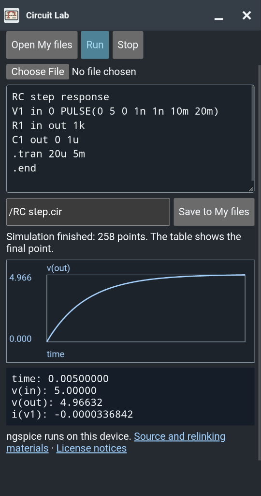
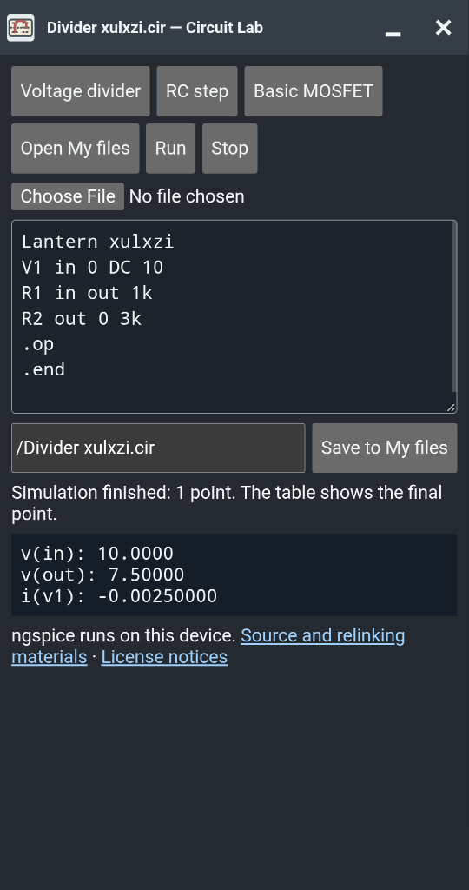

# Circuit Lab on the Galaxy S10+

Open **Electronics → Circuit Lab** and tap **Run**. The built-in voltage
divider starts at 10 V with two 1 kΩ resistors. The result table shows
`v(out): 5.00000`.

Choose **RC step** and run again. The plot shows output voltage rising
toward 5 V. At the final sample, 5 milliseconds, the solver returns
`v(out): 4.96632`. The plot uses the current WebOS color scheme and
renders its labels at the phone's display width.

## Keep an editable circuit

1. Choose **Voltage divider**. In the source editor, change R2 from
   `1k` to `2k`. Run the edited circuit and check for 6.66667 V.
2. Enter a bare name in the file field and choose **Save to My files**.
   Circuit Lab adds `.cir`. It also accepts explicit `.sp`, `.spice`
   and `.txt` filenames.
3. Close Circuit Lab and open the `.cir` from **My files**. Run it again.
   Change R2 to `3k` and save at the same path. The output is now 7.50000 V.

Signed-in files reopen in a fresh session. Guest files use temporary My
files within the current session. Cancelled Open and an invalid save
suffix preserve the editor text.

## Verification and build

The physical Galaxy S10+ ran Chrome 158.0.8127.92 at 411 CSS pixels wide.
The phone has a 44 CSS pixel Run button, a 16 pixel netlist editor and
14 pixel chart labels. Chromium 158.0.8127.36 replayed the editable
file cycle at 820 and 1300 CSS pixels. The desktop also checked the three
explicit suffixes, a native SP file import, AC and DC sweeps, the MOSFET
example and stopping an active worker.

The [build guide](../../README.md) documents the pinned solver inputs.
The new viewer builds from the mounted app and copies the verified solver
worker. The browser source archive refreshes the app JavaScript and CSS.
The checked source inventory, solver WASM, wrapper and 19 notices agree.
The real ngspice solver test, eight source-package audit tests and twelve
shared Files association checks passed.

The phone covered three of ten workflow groups: operating point,
transient response and the editable Files cycle. Desktop passed all
ten documented groups, including AC sweep, DC sweep, the MOSFET
example, explicit suffixes, native file import, Stop and a two-session
save conflict. The conflict check preserved the newer server file and
saved the stale editor's work as a separate copy.

Runtime revision `23c0d64e8d1b986f73e502928097aba97f538675` is live in
viewer `8a8be0c8cf3b1914d14fb1d3b5229e2dc59a95156c11d2527bdee5eeb655a705`.
All eleven changed paths matched over HTTPS. Both screenshots are from
the hosted S10+ guest replay.

[WebOS release and rollback](https://github.com/CC-David-CC/WebOS/blob/webos/circuit-phone-files/deploy/ACTIVE-RELEASE.md#circuit-lab-phone-plot-and-files)
